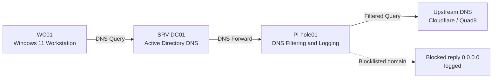
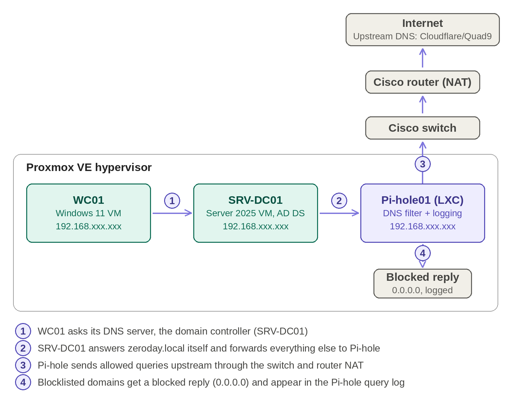
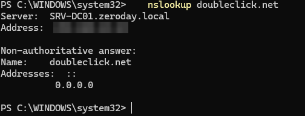
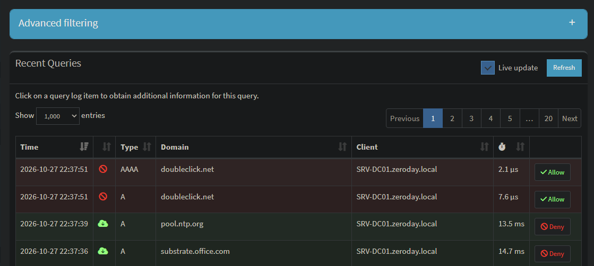
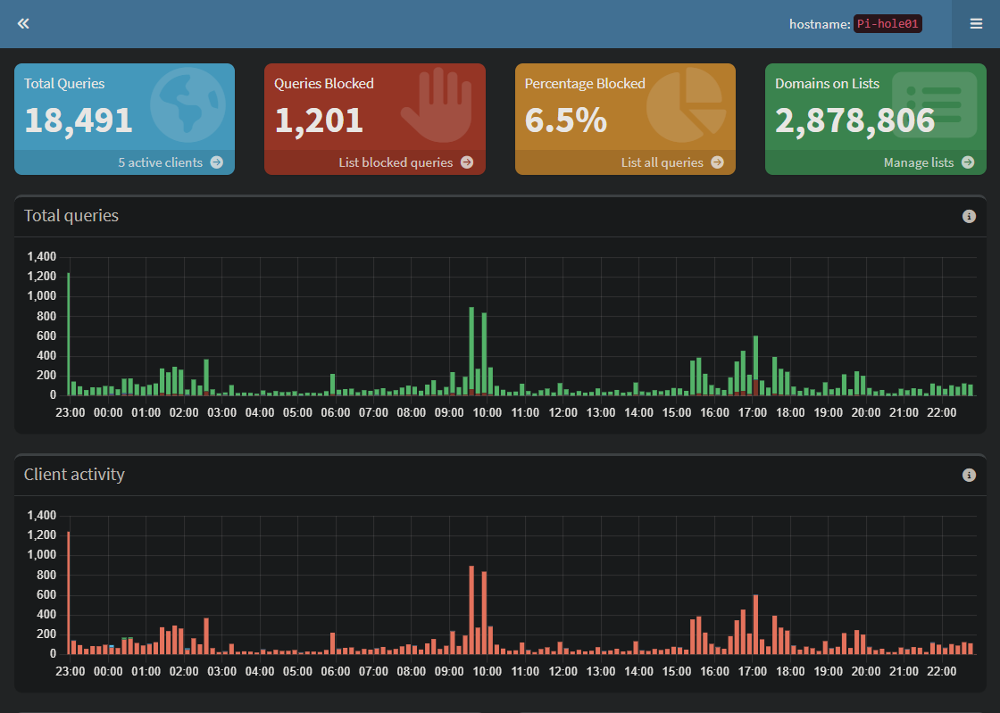

# Pi-hole DNS Filtering & Visibility Lab

**Enterprise-style DNS filtering, logging, and visibility in an Active Directory homelab.**


## Summary

I built a DNS filtering service with Pi-hole in a Proxmox homelab and connected it to a Windows Server 2025 Active Directory domain (`zeroday.local`). Pi-hole runs in a small, unprivileged Debian LXC container. The domain controller forwards all external DNS queries to Pi-hole, so every device in the domain gets ad, tracker, malware, and phishing filtering, and the queries are logged.

DNS is the first step of almost every connection, including malware calling home, so filtering and logging it gives low-cost protection and useful visibility.

## Key Results

| Metric | Result |
| --- | --- |
| Blocklists | 4 lists covering ads, trackers, malware, and phishing |
| Domains blocked | About 2.88 million unique domains |
| DNS queries (24 hours) | 18,491 |
| Queries blocked | 1,201 (6.5%) |
| Blocked reply | `0.0.0.0`, logged in the Pi-hole query log |
| DNS chain | WC01, then SRV-DC01, then Pi-hole, then upstream, verified end to end |

## Architecture

Clients do not talk to Pi-hole directly. The Windows 11 workstation uses the domain controller as its DNS server. The domain controller resolves `zeroday.local` itself and forwards everything else to Pi-hole, which blocks bad domains and sends the rest to the internet.



| Component | Platform | Role |
| --- | --- | --- |
| Cisco router / switch | Physical | NAT gateway and lab connectivity |
| pve01 | Proxmox VE 9.2 | Hypervisor |
| Pi-hole01 (CT 105) | Debian 12 LXC container, unprivileged | DNS filtering and logging |
| SRV-DC01 | Windows Server 2025 VM | Active Directory, DNS, forwards to Pi-hole |
| WC01 | Windows 11 Pro VM | Domain-joined client, uses SRV-DC01 for DNS |



## Implementation Overview

1. **Container:** created CT 105 from a Debian template as an unprivileged container (1 vCPU, 1 GiB RAM, 512 MiB swap, 2 GB disk), set to start at boot.
2. **OS hardening:** set the hostname, assigned a static IP, created a non-root admin user, enabled SSH key login, and disabled root and password login.
3. **Firewall:** enabled the Proxmox firewall for the container and allowed only SSH, DNS, HTTP, and HTTPS from the lab subnet, with a default drop policy.
4. **Pi-hole and blocklists:** installed Pi-hole, added four blocklists, and ran a gravity update.
5. **Active Directory integration:** added Pi-hole as the DNS forwarder on the domain controller, and enabled conditional forwarding in Pi-hole for `zeroday.local`.
6. **Validation:** tested the full chain from the client with `nslookup`, then confirmed the results in the query log and dashboard.

Full step-by-step write-up with screenshots: [`docs/PiHole_DNS_Security_Lab.pdf`](docs/PiHole_DNS_Security_Lab.pdf)

## Configuration Notes

Values are sanitized. Replace the placeholders with your own addresses.

**Container (Proxmox CT 105)**

| Setting | Value |
| --- | --- |
| OS template | Debian 12 |
| Unprivileged | Yes |
| Resources | 1 vCPU, 1 GiB RAM, 512 MiB swap, 2 GB root disk |
| Start at boot | Yes |
| Network | Static IPv4 on `eth0` (`<PIHOLE_IP>/24`), gateway `<GATEWAY_IP>` |

**SSH hardening** (`/etc/ssh/sshd_config.d/99-hardening.conf`)

```
PermitRootLogin no
PasswordAuthentication no
PubkeyAuthentication yes
```

**Proxmox firewall (CT 105)**

| Direction | Action | Macro | Source |
| --- | --- | --- | --- |
| in | ACCEPT | SSH | `<LAB_SUBNET>/24` |
| in | ACCEPT | DNS | `<LAB_SUBNET>/24` |
| in | ACCEPT | HTTP | `<LAB_SUBNET>/24` |
| in | ACCEPT | HTTPS | `<LAB_SUBNET>/24` |

Container firewall options: Firewall = Yes, input policy = DROP, output policy = ACCEPT. The Datacenter firewall must also be enabled for container rules to apply, with explicit rules allowing management access to the Proxmox host (web interface and SSH) added first.

**Blocklists**

| List | Purpose | URL |
| --- | --- | --- |
| StevenBlack hosts (default) | Ads and trackers | `https://raw.githubusercontent.com/StevenBlack/hosts/master/hosts` |
| Phishing Army (extended) | Phishing domains | `https://phishing.army/download/phishing_army_blocklist_extended.txt` |
| Blocklist Project: malware | Malware domains | `https://blocklistproject.github.io/Lists/malware.txt` |
| CyberHost malware | Malware domains | `https://lists.cyberhost.uk/malware.txt` |

**DNS forwarding**

| Where | Setting |
| --- | --- |
| SRV-DC01 (DNS Manager, Forwarders) | Forwarder: `<PIHOLE_IP>`, root hints enabled as fallback |
| Pi-hole (Settings, DNS, Conditional forwarding) | Network `<LAB_SUBNET>/24`, server `<DC_IP>`, domain `zeroday.local` |
| WC01 (network adapter) | DNS server: `<DC_IP>` (set manually, DHCP off) |

## Validation

Tests were run from WC01. The key test names no DNS server, so the query follows the normal path through the domain controller.

| Test | Command | Result |
| --- | --- | --- |
| Normal domain | `nslookup example.com <PIHOLE_IP>` | Resolved to a real IP |
| Blocked domain through the chain | `nslookup doubleclick.net` | Server: SRV-DC01, returned `0.0.0.0` (blocked) |
| Internal AD name | `nslookup srv-dc01.zeroday.local <PIHOLE_IP>` | Returned the domain controller IP |
| Query log check | Pi-hole Query Log | Blocked lookup shown with client SRV-DC01 |

The query log also shows the domain controller's normal background lookups (time sync and Microsoft services) being allowed, so Pi-hole filters selectively and does not block everything.





## Screenshots

<details>
<summary>View all screenshots (IP and MAC addresses are blurred)</summary>

| # | Screenshot | What it shows |
| --- | --- | --- |
| 02 | [Container summary](screenshots/02-ct-summary.png) | Running, unprivileged, low resource use |
| 03 | [Container resources](screenshots/03-ct-resources.png) | 1 core, 1 GiB RAM, 512 MiB swap, 2 GB disk |
| 04 | [Container options](screenshots/04-ct-options.png) | Start at boot, unprivileged |
| 05 | [hostnamectl](screenshots/05-hostnamectl.png) | Debian 12, LXC |
| 06 | [ip a](screenshots/06-ip-a.png) | Static address on eth0 |
| 07 | [SSH test](screenshots/07-ssh-test.png) | Root login denied, admin logs in with key |
| 08 | [SSH settings](screenshots/08-ssh-settings.png) | Active SSH hardening settings |
| 09 | [Container network](screenshots/09-ct-network.png) | Static IPv4 configuration |
| 10 | [Firewall rules](screenshots/10-firewall-rules.png) | HTTPS, HTTP, DNS, SSH from the lab subnet |
| 11 | [Firewall options](screenshots/11-firewall-options.png) | Firewall enabled, input policy DROP |
| 12 | [Blocklists](screenshots/12-blocklists.png) | Four lists enabled |
| 13 | [Gravity update](screenshots/13-gravity-update.png) | 2,878,806 unique domains |
| 14 | [DC forwarder](screenshots/14-dc-forwarder.png) | Domain controller forwards to Pi-hole |
| 15 | [Conditional forwarding](screenshots/15-conditional-forwarding.png) | `zeroday.local` sent to the domain controller |
| 16 | [WC01 ipconfig](screenshots/16-wc01-ipconfig.png) | Client DNS is the domain controller |
| 17 | [nslookup chain](screenshots/17-nslookup-chain.png) | Blocked through the DC, returns `0.0.0.0` |
| 18 | [nslookup direct](screenshots/18-nslookup-direct.png) | Normal, blocked, and internal lookups |
| 19 | [Query log](screenshots/19-query-log.png) | Blocked lookups with client SRV-DC01 |
| 20 | [Dashboard](screenshots/20-dashboard.png) | 24-hour query and block statistics |

</details>

## Troubleshooting

| Problem | Cause | Fix |
| --- | --- | --- |
| First blocked-domain test did not prove the real DNS path | `nslookup` was pointed straight at Pi-hole, skipping the domain controller | Re-tested with no server named and checked that the query log client was SRV-DC01 |
| Lost access to the Proxmox web interface after enabling the firewall | Enabling the Datacenter firewall started enforcing the default drop policy, and no rule explicitly allowed management access | Used the physical console to disable the Datacenter firewall, then created explicit management rules before enabling it again |

## Limitations and Next Steps

- Pi-hole is a single point of filtering. If it stops, the domain controller falls back to root hints and filtering is lost. A second Pi-hole would add redundancy.
- Queries forwarded by the domain controller appear in Pi-hole as coming from SRV-DC01, so Pi-hole cannot apply different rules to individual workstations behind it.
- Apps using encrypted DNS (DoH) can bypass filtering unless blocked at the firewall.
- Next: forward Pi-hole logs to a Wazuh SIEM and add scheduled backups.

## Key Insight

In an Active Directory environment, Pi-hole primarily sees the Domain Controller as the DNS client. Achieving workstation-level DNS visibility requires a different DNS architecture or endpoint-based logging.

## Skills Demonstrated

Proxmox LXC containers, DNS and DNS forwarding, Pi-hole, Active Directory and Windows Server DNS, Linux hardening (SSH keys, firewall), network troubleshooting, log analysis, technical documentation.

## Repository Structure

```
Pi-hole-DNS-Security-Lab/
├── README.md
├── docs/
│   ├── PiHole_DNS_Security_Lab.pdf
│   └── infographic.png
└── screenshots/
    └── 01-dns-flow.png ... 20-dashboard.png
```

## Related Project

[Active Directory & Windows Security Lab](https://github.com/zdhomelab/AD-WS-Lab): the Windows domain environment this project builds on.

## Disclaimer

This is a personal homelab built for learning. IP addresses and MAC addresses in the screenshots are blurred or replaced with placeholders.
